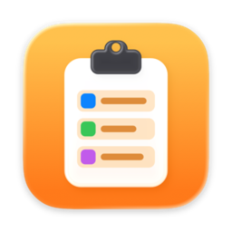
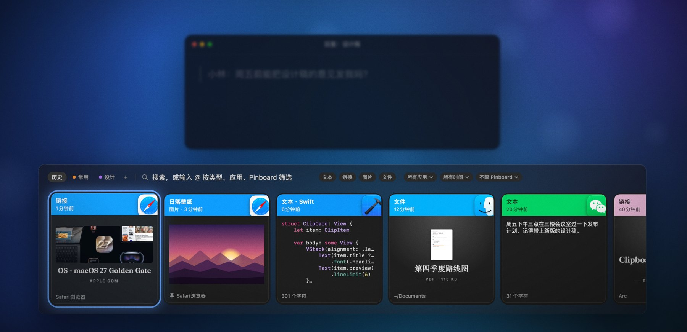
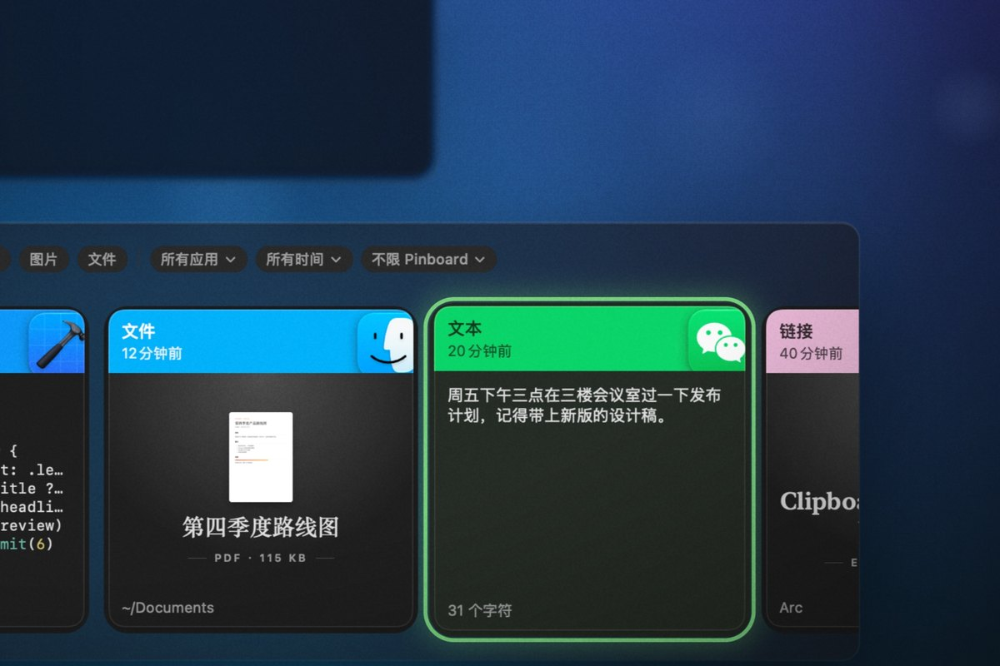
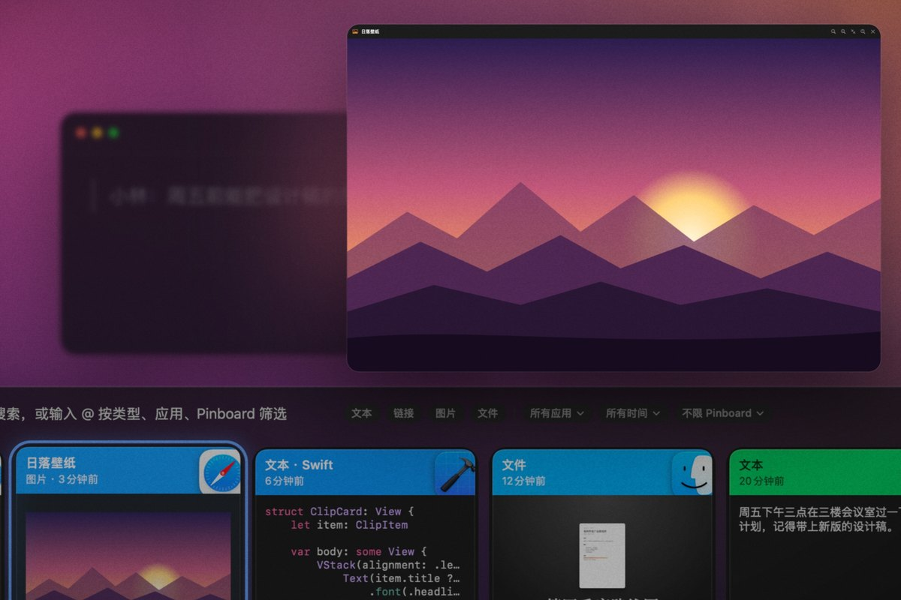
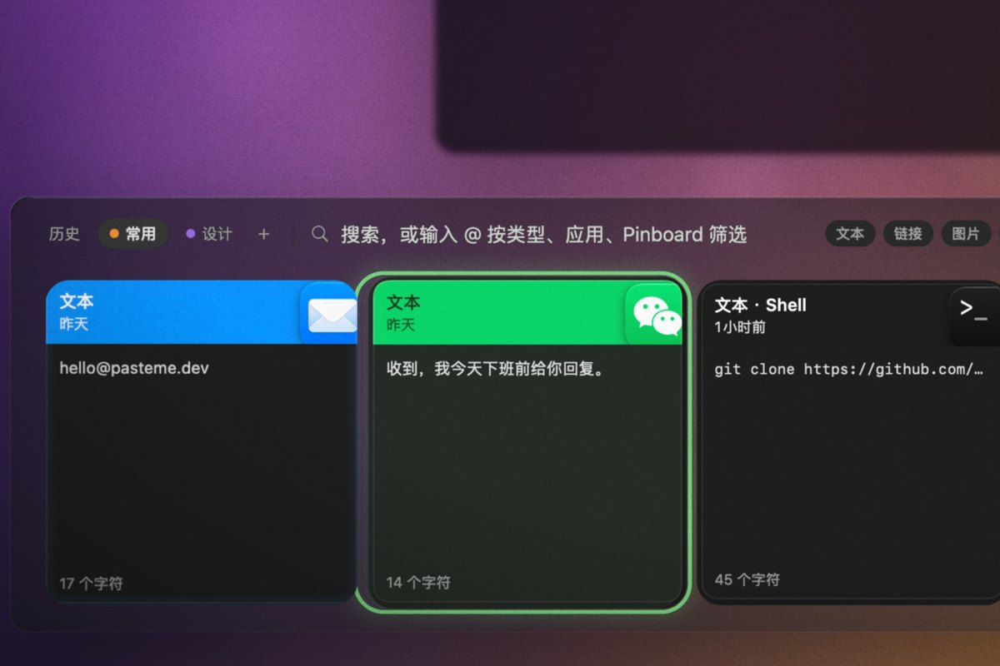
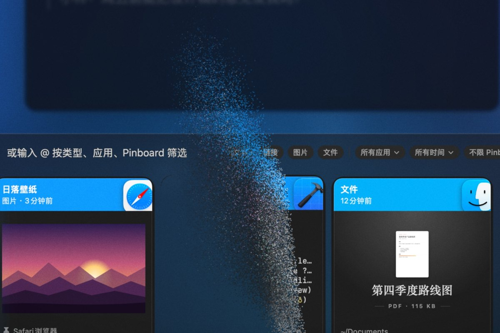

<p align="center">
  
</p>

<h1 align="center">PasteMe</h1>

<p align="center">
  Mac 上的剪贴板历史。复制过的东西都留着，按 ⇧⌘V 找回来，按 ↩︎ 粘贴出去。
</p>

<p align="center">
  <a href="https://github.com/Skjz/pasteMe/releases/latest"><b>下载最新版</b></a>
  &nbsp;·&nbsp; macOS 14 及以上 &nbsp;·&nbsp; 免费开源 &nbsp;·&nbsp; <a href="README.en.md">English</a>
</p>

<p align="center">
  
</p>

## 30 秒演示

https://github.com/user-attachments/assets/3354eec4-f3db-4d77-bcdc-d2529a14f3c0

## 它能做什么

<table>
  <tr>
    <td width="50%" valign="top">
      
      <h3>卡片带着来源应用的颜色</h3>
      文字、链接、图片、文件和代码都记下来，一眼就能认出是从哪个应用复制的。
    </td>
    <td width="50%" valign="top">
      
      <h3>按空格预览</h3>
      长文本看全文，图片看原图，链接直接看网页，不用打开别的应用。
    </td>
  </tr>
  <tr>
    <td width="50%" valign="top">
      
      <h3>截图里的字也能搜到</h3>
      复制图片后，PasteMe 在本机识别里面的文字。搜「报销」，就能找到那张小票。
    </td>
    <td width="50%" valign="top">
      
      <h3>常用的内容放进 Pinboard</h3>
      邮箱、常用回复、命令固定下来，按 ⌘← ⌘→ 在历史和各个 Pinboard 之间切换。
    </td>
  </tr>
  <tr>
    <td width="50%" valign="top">
      
      <h3>删错了，按 ⌘Z</h3>
      按 ⌘⌫ 删除，卡片碎成颗粒飘走；按 ⌘Z，颗粒飘回来拼成原样。
    </td>
    <td width="50%" valign="top">
      
      <h3>按 ↩︎ 直接粘贴</h3>
      选中卡片按回车，面板收起，内容直接粘贴到你正在用的应用里。
    </td>
  </tr>
</table>

还有：

- **Paste Stack**：按 ⌃⇧⌘C 后连续复制几段，再一下一下按 ⌘V，按复制的顺序依次粘贴。
- **认得出代码和常见格式**：代码按语言着色；颜色值、时间戳、Base64、hex 有自己的样子，右键「转换」可以互相转换、算哈希值。
- **筛选**：输入 `@` 按类型、来源应用、Pinboard 筛选，也能按时间筛选。
- **拖出去**：把卡片拖进任何应用，文件还是原来的文件，图片同时给出图片和 PNG 文件。
- **自己检查更新**：有新版本时菜单栏菜单里会出现「更新到…」，点一下就装好，安装包要有发布者的签名才会安装。

每一项的细节见[使用说明](docs/guide.md)。

## 隐私

- 历史只存在你的 Mac 上，不上传到任何地方。
- 密码管理器标记为敏感的内容不会被记下来。
- 共享屏幕、录屏、截图时，别人看不到面板。
- 会联网的只有三处：每天检查一次更新（可以关掉）；你在设置里打开的链接预览（默认关闭）；你按空格预览网页时。

## 常用按键

| 按键 | 作用 |
| --- | --- |
| ⇧⌘V | 呼出面板 |
| ← → | 选择卡片 |
| ↩︎ | 粘贴到当前应用（⇧↩︎ 以纯文本粘贴） |
| 直接打字 | 搜索，包括图片里的文字 |
| 空格 | 预览 |
| ⌘1 … ⌘9 | 直接粘贴第 1 … 9 张 |
| ⌘⌫ / ⌘Z | 删除 / 撤销 |
| ⌘P | 固定到 Pinboard |

完整的按键表见[使用说明](docs/guide.md#按键)。三个全局快捷键（呼出面板、暂停记录、Paste Stack）可以在设置里改。

## 安装

1. 从 [Releases](https://github.com/Skjz/pasteMe/releases/latest) 下载 `PasteMe-<版本>.dmg`，打开后把 PasteMe 拖进「应用程序」。
2. 第一次打开时系统会拦下，因为 PasteMe 没有经过 Apple 公证。到「系统设置 → 隐私与安全性」，在「安全性」下面点「仍要打开」。也可以在终端里运行这一行，去掉下载标记：

   ```bash
   xattr -dr com.apple.quarantine /Applications/PasteMe.app
   ```

3. 在「系统设置 → 隐私与安全性 → 辅助功能」里打开 PasteMe 的开关。没有这项权限也能用，只是选中后要自己按 ⌘V。

以后的新版本在菜单栏菜单里点「更新到…」就能装好，授权不用重新打开。

## 更多

- [使用说明](docs/guide.md)：每一项功能的细节。
- [开发](docs/development.md)：构建、测试和代码结构。
- [更新记录](CHANGELOG.md)

接下来打算做：在设置里选择不记录哪些应用；PDF、视频等文件的缩略图；iCloud 同步。

PasteMe 的界面和交互参考了 [Paste](https://pasteapp.io)。

PasteMe 以 [MIT 协议](LICENSE)开源。
